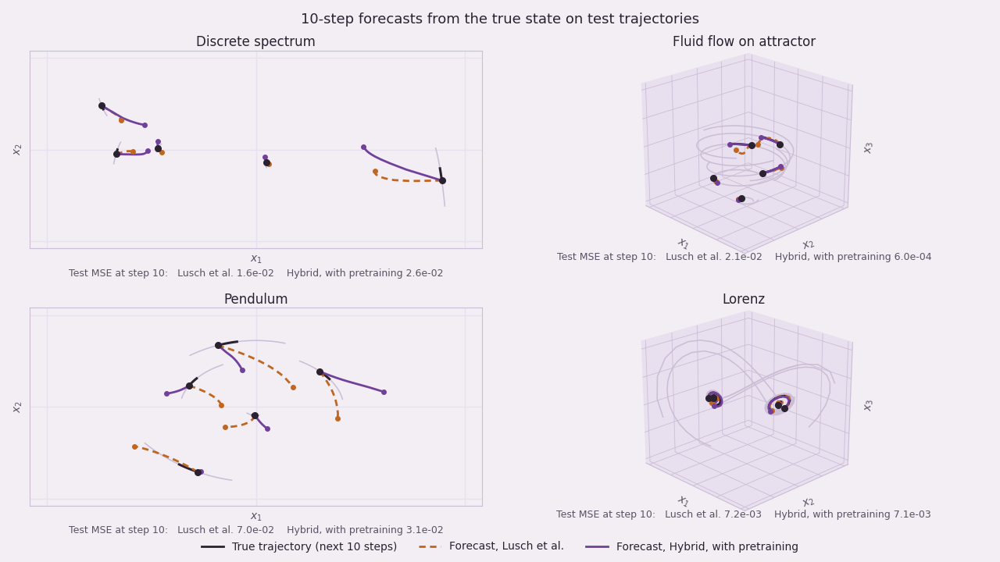

# HybridKoopman

Code for "A Hybrid Framework for Efficient Koopman Operator Learning" (L. Jung, A. Spiro,
A. Estornell, M. Everett, M. Sznaier, IEEE CDC 2025). [arXiv:2504.18676](https://arxiv.org/abs/2504.18676)

The method first solves a semidefinite program (SDP) on trajectory data to find a Koopman
operator and the dimension of its lifted space. A deep Koopman network in the style of Lusch,
Kutz and Brunton (2018) is then built with that dimension and eigenvalue structure. Its
auxiliary networks are pretrained on the SDP eigenvalues before the full network is trained.

<p align="center"></p>

## Contents

| Path | Contents |
|---|---|
| `hybrid_koopman/` | Model, losses, training schedule, data loading and prediction |
| `scripts/` | `train.py`, `evaluate.py`, `make_video.py`, `convert_legacy.py` |
| `checkpoints/` | Trained models for the four systems and three training modes |
| `data/sdp/` | SDP results used to build and pretrain the hybrid models |
| `data/samples/` | Reference forecasts of the original research code, used by the tests |
| `matlab/` | SDP solver (`run_sdp.m`) and data generators (`data/`) |
| `tests/` | Unit tests and a check that the checkpoints reproduce the original forecasts |

## Installation

```bash
git clone https://github.com/neu-autonomy/HybridKoopman.git
cd HybridKoopman
pip install -e ".[video,test]"      # or: pip install -r requirements.txt
```

The code runs on CPU. It requires Python 3.9 or later and PyTorch 2.0 or later.

## Data

The trajectory files (about 136 MB) are not stored in the repository. Place them in
`data/csv/` as `{System}_train1_x.csv` and `{System}_test_x.csv`, or regenerate them in MATLAB
with the scripts in `matlab/data/` (see the README there). Each file holds one state per row,
with trajectories stored as consecutive blocks.

The SDP results in `data/sdp/` are included. To recompute them, install
[CVX](http://cvxr.com/cvx/) with the SDPT3 solver and run `matlab/run_sdp.m` from the
`matlab/` directory.

## Usage

Evaluate the released checkpoints on the test split:

```bash
python scripts/evaluate.py --horizons 1 10 30
```

Train a model. The defaults reproduce the paper's settings.

```bash
python scripts/train.py --system Pendulum --mode hybrid
```

The modes are `lusch` (eigenvalue count from Lusch et al., auxiliary networks randomly
initialized), `hybrid_no_pretrain` (latent size, memory and eigenvalue structure from the SDP)
and `hybrid` (as `hybrid_no_pretrain`, with the auxiliary networks pretrained on the SDP
eigenvalues). The systems are `DiscreteSpectrumExample`, `FluidFlowOnAttractor`, `Pendulum` and
`Lorenz`.

Render the forecast video:

```bash
python scripts/make_video.py --out koopman.mp4 --poster koopman.png
```

Load a checkpoint in Python:

```python
from hybrid_koopman import HybridKoopman, Normalizer, forecast, load_trajectories

model, meta = HybridKoopman.load("checkpoints/Pendulum_hybrid.pt")
x = Normalizer.from_dict(meta["normalizer"])(load_trajectories("data/csv/Pendulum_test_x.csv", 51))
pred = forecast(model, x, n_steps=10)     # (trajectories, start times, steps, state dimension)
```

Run the tests with `pytest`. The checkpoint test needs only the files in the repository.

## Results

Mean squared error of the released checkpoints on the test split, in normalized coordinates
([-1, 1] per state component). The error is averaged over all test trajectories and all start
times that admit a 30-step forecast. Output of `scripts/evaluate.py --horizons 1 10 30`:

| System | Mode | MSE, 1 step | MSE, 10 steps | MSE, 30 steps |
|---|---|---|---|---|
| Discrete spectrum | Lusch et al. | 7.07e-3 | 1.97e-2 | 2.61e-2 |
| | Hybrid, without pretraining | 7.07e-3 | 1.97e-2 | 2.61e-2 |
| | Hybrid, with pretraining | 1.17e-2 | 3.00e-2 | 2.85e-2 |
| Fluid flow on attractor | Lusch et al. | 2.22e-4 | 2.07e-2 | 1.02e-1 |
| | Hybrid, without pretraining | 2.17e-5 | 1.66e-3 | 1.13e-2 |
| | Hybrid, with pretraining | 6.20e-6 | 5.99e-4 | 5.13e-3 |
| Pendulum | Lusch et al. | 8.61e-4 | 7.12e-2 | 3.39e-1 |
| | Hybrid, without pretraining | 8.61e-4 | 7.12e-2 | 3.39e-1 |
| | Hybrid, with pretraining | 4.15e-4 | 3.13e-2 | 1.74e-1 |
| Lorenz | Lusch et al. | 2.27e-4 | 7.98e-3 | 1.80e-2 |
| | Hybrid, without pretraining | 1.07e-4 | 9.37e-3 | 8.22e-3 |
| | Hybrid, with pretraining | 4.74e-5 | 8.35e-3 | diverges (see below) |

## Notes on reproduction

This release was rebuilt from the research code. The released checkpoints are the original
trained weights, converted with `scripts/convert_legacy.py`. `tests/test_release.py` checks
that their forecasts agree with those of the original code to 1e-4. The following points
affect reproduction.

* **Prediction horizon.** The loss uses k = 10 prediction steps (`num_shifts`). This value is
  the default of the original code. The checkpoints do not record it.
* **Training schedule.** The batch size, the number of epochs and the length of each training
  phase were recovered from the optimizer step counts stored in the original checkpoints.
* **Loss details.** The original loss has three implementation details that differ from the
  written loss: a broadcast in the infinity-norm term, the order of the per-horizon weights,
  and the order of the pretraining targets for Lorenz. They are kept by default so that
  training matches the released models. `--no-legacy` uses the written loss.
  `hybrid_koopman/losses.py` describes each one.
* **Validation split.** The original code evaluated the test split during training and used no
  separate validation split. The numbers above therefore do not come from held-out model
  selection.
* **Identical baselines.** For the discrete spectrum and pendulum systems the SDP gives the
  same latent size and eigenvalue structure as Lusch et al. On these systems the `lusch` and
  `hybrid_no_pretrain` checkpoints give identical results.
* **Discrete spectrum.** The 1-step error of the `hybrid` checkpoint (1.17e-2) does not match
  the value reported in the paper (3.73e-6). For the other three systems the 1-step error
  agrees with the paper within 12%.
* **Slow systems.** On the discrete spectrum and pendulum systems the true state moves about
  0.06 and 0.09 (normalized units) in 10 steps. The models move their prediction 2.5 to 4.5
  times as far over the same horizon. On the fluid flow and Lorenz systems the predicted and
  true displacements agree within 11%.
* **Lorenz at long horizons.** 23 of about 450,000 test forecasts of the `hybrid` Lorenz model
  overflow, all at horizons of 20 steps or more. The 1- and 10-step errors are finite.
* **Lorenz sampling.** The Lorenz generator reuses the time vector returned by `ode45`, so the
  sampling interval is not constant. `matlab/data/README.md` explains this. The script is kept
  unchanged because the released models were trained on its output.

## Citation

```bibtex
@inproceedings{jung2025koopman,
  title     = {A Hybrid Framework for Efficient Koopman Operator Learning},
  author    = {Jung, Leonard and Spiro, Alenna and Estornell, Alexander and Everett, Michael and Sznaier, Mario},
  booktitle = {2025 IEEE 64th Conference on Decision and Control (CDC)},
  pages     = {4214--4220},
  year      = {2025}
}
```

## Acknowledgments

The network, the loss and the data generators follow
[DeepKoopman](https://github.com/BethanyL/DeepKoopman) by Bethany Lusch (MIT License,
copyright 2018 Bethany Lusch): B. Lusch, J. N. Kutz and S. L. Brunton, "Deep learning for
universal linear embeddings of nonlinear dynamics," *Nature Communications* 9, 4950 (2018).
